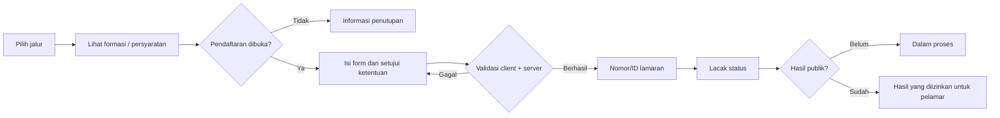

# DESIGN — Sistem Desain Portal Rekrutmen UI

> **Status dokumen:** diturunkan melalui analisis statis dari arsip sumber yang diberikan, 31 Oktober 2026. Dokumentasi ini bukan bukti bahwa seluruh integrasi telah diuji secara live atau bahwa implementasi memenuhi seluruh persyaratan keamanan.

## 1. Prinsip visual dan tujuan UX

- **Terpercaya dan institusional:** navy dominan pada header, hero, dan elemen primer; kuning sebagai penanda tindakan/aksen.
- **Terbaca dan terarah:** judul jelas, kartu berlapis dengan border lembut dan radius besar, notifikasi status yang berbeda secara visual.
- **Pelamar sebagai pengguna utama:** jalur «pilih rekrutmen → baca persyaratan → isi formulir → kirim → lacak» harus dipahami tanpa mengenal Apps Script.
- **Pengurangan risiko:** pesan error harus bisa ditindaklanjuti, perubahan status tidak boleh menampilkan data internal.

## 2. Palet warna yang teramati pada CSS

| Token dokumentasi | Hex | Penggunaan yang ditemukan/selaras |
|---|---|---|
| `brand.navy` | `#173A63` | Latar hero, heading utama, tombol/komponen aktif. |
| `brand.navyDeep` | `#0B1F3A` | Teks/kontras gelap dan elemen kontainer. |
| `brand.navyMid` | `#214F7A` | Gradien dan penegasan sekunder. |
| `brand.yellow` | `#FACC15` | Ikon, CTA, badge, border aksen, focus. |
| `neutral.muted` | `#64748B` | Deskripsi, meta label, bantuan. |
| `neutral.surface` | `#F8FAFC` | Background sekunder dan bidang lunak. |
| `neutral.line` | `#E2E8F0` | Divider dan border. |
| `neutral.white` | `#FFFFFF` | Kartu/form/dialog. |
| `semantic.danger` | `#963A34` | Konteks pendaftaran ditutup pada modul PTT (bukan satu-satunya warna peringatan). |

**Catatan implementasi:** stylesheet memuat banyak override/patch serta ejaan hex kapital/kecil; daftar di atas adalah pengelompokan dokumenter, **bukan token terpusat yang sudah diterapkan**. Sebelum refactor, audit cascade agar visual production tidak berubah.

## 3. Tipografi, jarak, grid, ikon

- Gaya penggunaan font mengandalkan fallback sans-serif (`Arial`, `Helvetica`, `sans-serif`) pada bagian tertentu dan utilitas Tailwind CSS pada halaman utama.
- Heading hero berskala responsif; banyak judul/label memakai weight 900–950, letter spacing rapat pada hero, dan label kecil berhuruf kapital.
- Surface kartu putih dengan border tipis dan bayangan; radius berkisar sekitar 14–32 px di berbagai komponen.
- Modul PTT menggunakan grid kartu dua kolom pada desktop, dan aturan media query untuk adaptasi layar kecil (mis. breakpoint `820px` di stylesheet).
- Ikon memakai Font Awesome; aksi bersifat jelas (pilih, cari, kembali, tutup, kirim, unduh/pratinjau).
- Rekomendasi: lanjutkan menggunakan satu skala spacing 4/8/12/16/24/32 px dan token radius, tetapi jangan menganggap ini sudah menjadi single source of truth.

## 4. Struktur halaman dan navigasi

1. **Shell:** navbar desktop/mobile, hero, kartu pemilihan jalur rekrutmen, menu pengumuman, panduan, tanya-jawab, dan Lacak Status.
2. **PTT lazy module:** HTML modul dimuat sesuai kebutuhan oleh server lalu ditampilkan dalam shell. Ada jalur pemilihan formasi dan fungsi pencarian/filter.
3. **Halaman informasi:** tahapan rekrutmen, panduan data, syarat, dan pop-up pengumuman awal dengan variasi layout.
4. **Footer:** bagian informasi dan indikator kunjungan pada shell. Angka statistik tergantung data service.
5. **Admin:** kode backend admin tersedia; desain UI admin tidak dapat dipastikan dari arsip tanpa file frontend admin.

## 5. Cara modal/pop-up dirender

| Modal/overlay yang teridentifikasi | Pemicu umum | Perilaku yang teramati/dapat diverifikasi di sumber |
|---|---|---|
| Pop-up pengumuman awal | Pada pembukaan/siklus informasi portal | Overlay fixed, z-index sangat tinggi, head navy dan aksen kuning; aturan tampilan/ukuran khusus. |
| Terms & conditions PTT | Sebelum melanjutkan pendaftaran tertentu | Dialog dengan `role=dialog`, `aria-modal`, checkbox persetujuan, tombol lanjut dinonaktifkan hingga syarat terpenuhi. |
| Detail/form PTT | Aksi pada kartu formasi atau jalur yang dipilih | Konten dan field dibuat/diperbarui via JavaScript, ditampilkan dalam kontainer modal/halaman dinamis; perubahan pilihan menyesuaikan field. |
| Form manajerial eksternal | Aksi melamar di jalur manajerial | Overlay fixed dengan tombol tutup, field data dan upload yang terlihat di file HTML. |
| Daftar/pratinjau pengumuman | Klik menu pengumuman | Dialog berlabel; beralih dari daftar ke PDF canvas menggunakan PDF.js, dilengkapi aksi kembali/tutup. |
| Umpan balik/konfirmasi status | Pendaftaran, validasi, pelacakan | Elemen hasil inline dan komponen popup/alert termasuk SweetAlert2 tergantung jalur. |

**Aturan desain untuk pengembangan:** saat membuka modal, gunakan heading terasosiasi, fokus awal yang jelas, tombol tutup operasional, `Escape`, pengembalian fokus saat tutup, scroll lock terbatas, dan dialog berukuran viewport aman. Beberapa atribut ARIA terdeteksi, **namun pengujian menyeluruh focus trap/keyboard belum dilakukan**.

## 6. Formulir, field dan alur validasi

### 6.1 Form jalur PTT

Pola field yang tertulis dalam kontrak/backend mencakup:

- **Jalur & formasi:** jenis rekrutmen, pilihan unit/formasi dan data kebutuhan, bidang/jalur terkait.
- **Identitas pelamar:** nama lengkap, tempat/tanggal lahir, jenis kelamin, email, nomor HP/WhatsApp, alamat domisili.
- **Pendidikan:** pendidikan terakhir, jenis perguruan tinggi, kampus, program studi, tahun lulus, nomor ijazah, IPK.
- **Pengalaman:** hingga beberapa riwayat pekerjaan, peran, institusi, tanggal, tanggung jawab, pengalaman relevan.
- **Profil profesional:** keahlian, sertifikasi/pelatihan, motivasi, ekspektasi gaji, tautan portofolio, kesiapan mulai bekerja, sumber informasi.
- **Persetujuan dan identitas permintaan:** consent serta penanda request untuk membantu idempotensi.

**Bukan semua field wajib pada setiap jalur.** Field `required` dan visibilitas berbeda menurut jenis rekrutmen dan schema formulir; tentukan daftar wajib yang akurat dari kondisi runtime + schema server untuk formasi yang dipilih. `novalidate` pada form tertentu berarti validasi JavaScript mempunyai peranan penting. Validasi klien tidak menggantikan validasi server.

### 6.2 Form Lacak Status

Menggunakan **email dan nomor telepon** yang sesuai pendaftaran. Server melakukan normalisasi identitas dan mengembalikan ringkasan publik. Pesan “tidak ditemukan”, “dalam proses”, dan “hasil tersedia” harus dibedakan tanpa membuka rincian internal atau mengonfirmasi data yang tidak boleh diketahui pihak lain.

### 6.3 Form manajerial eksternal

Field yang dapat diobservasi pada HTML: NIK, nama, email, HP, program studi, institusi, tahun kelulusan, jabatan, dan opsi berkas foto/ijazah/sertifikat. **Ketersediaan penyimpanan dan persyaratan upload harus diverifikasi pada backend terkait**; tidak semua backend eksternal termasuk dalam arsip.

## 7. State, error, feedback dan copywriting

| Keadaan | Pola konten/teks yang dianjurkan | Alasan |
|---|---|---|
| Loading | “Memuat informasi rekrutmen…” | Menghindari kesan tombol tidak bekerja. |
| Sukses submit | “Pendaftaran berhasil diterima. Simpan ID lamaran Anda.” | Memberi langkah selanjutnya secara jelas. |
| Submit ganda | “Pendaftaran Anda sudah tercatat. Gunakan Lacak Status.” | Mengurangi permintaan ulang dan duplikasi. |
| Registrasi ditutup | “Pendaftaran sudah ditutup untuk periode ini.” | Menghindari kebingungan atas CTA disabled. |
| Gagal sementara | “Layanan sedang sibuk. Coba kembali beberapa saat lagi.” | Tidak mengekspos detail internal. |
| Belum ditemukan | “Data belum ditemukan. Periksa email dan nomor HP saat pendaftaran.” | Membantu koreksi identitas, tanpa detail tabel. |
| Belum dipublikasikan | “Hasil seleksi belum diumumkan.” | Konsisten dengan gate publikasi. |

Ini adalah **panduan editorial**, bukan kutipan 1:1 dari setiap cabang aplikasi. Utamakan bahasa Indonesia formal, langsung, empatik, bebas istilah backend, tanpa menjanjikan lulus/diterima sebelum ada keputusan resmi. Bedakan status *Submitted*, *Dalam Proses*, *Lolos*, dan *Belum Lolos* sesuai kebijakan publikasi yang berlaku.

## 8. Responsiveness dan aksesibilitas

- Prioritaskan mobile-first untuk kartu/form, lebar modal dibatasi `viewport`, tombol cukup besar, spacing input yang nyaman.
- Uji responsive navbar, grid daftar formasi, pencarian, scroll modal, countdown, pdf preview, keyboard, screen reader, loading, dan error.
- Kontras warna kuning pada putih/abu-abu perlu diuji terutama pada teks kecil; gunakan teks navy pada latar kuning agar dapat terbaca.
- Pastikan semua input memiliki label yang terbaca dan error terhubung dengan field; jangan mengandalkan placeholder saja.
- Semua perubahan UI harus dicocokkan dengan tampilan source karena CSS memiliki banyak patch cascading.

## 9. UX lifecycle / state diagram

---

**Lingkup:** desain **portal pelamar yang terlihat** dalam arsip. Tidak berpretensi menggambarkan Admin UI yang source-nya tidak tersedia. Untuk dokumentasi teknis, buka `docs/specs` dan `docs/structures`.
