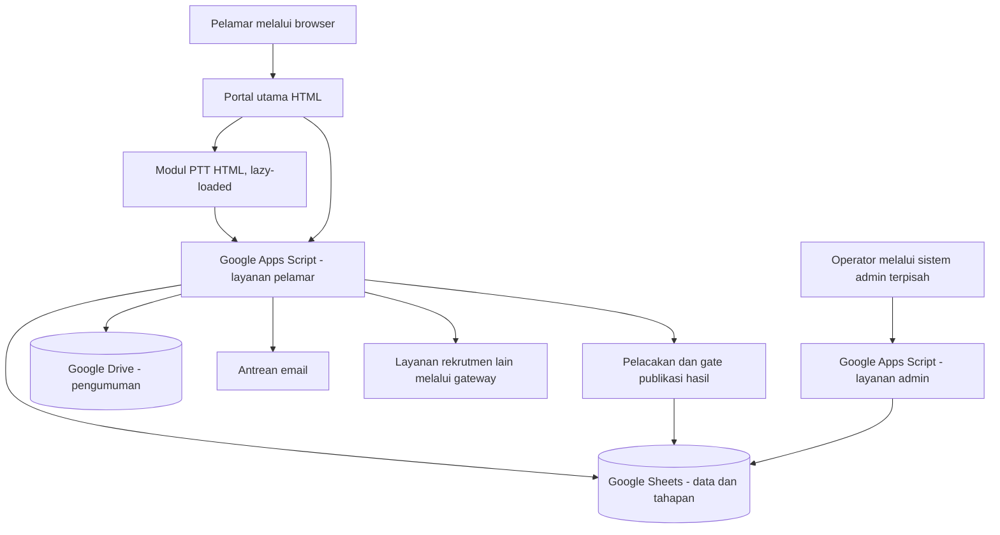

# Portal Rekrutmen UI — Dokumentasi Proyek

> **Status dokumen:** diturunkan melalui analisis statis dari arsip sumber yang diberikan, 31 Oktober 2026. Dokumentasi ini bukan bukti bahwa seluruh integrasi telah diuji secara live atau bahwa implementasi memenuhi seluruh persyaratan keamanan.

## Ringkasan

**Portal Rekrutmen UI** adalah sistem rekrutmen berbasis **Google Apps Script**, **HTML/CSS/JavaScript** dan **Google Sheets/Drive**. Komponen dalam arsip mendukung pengalaman pelamar (informasi formasi, pendaftaran, pelacakan status, pengumuman) serta layanan backend terpisah untuk pengelolaan seleksi dan administrasi. Ada pula integrasi / gerbang ke modul rekrutmen lain. Sistem mengikuti pola aplikasi web yang dihidangkan dari Apps Script; **ini bukan proyek Node.js/React siap deploy**.

Tujuan: menyatukan informasi rekrutmen, mengurangi submit ganda, membuat status seleksi lebih mudah dilacak, memisahkan tanggung jawab backend pelamar dan backend admin, serta mengendalikan waktu publikasi informasi sensitif.

## Fitur yang ditemukan di sumber

- **Portal publik:** pilihan jalur rekrutmen, informasi formasi, panduan, FAQ, pengumuman, dan pelacakan lamaran.
- **Modul PTT:** pilihan jalur fungsional / tenaga kesehatan / laboran, pencarian dan penyaringan formasi, panduan persyaratan, formulir dinamis, persetujuan ketentuan, dan draft sisi klien.
- **Layanan pendaftaran:** validasi dan normalisasi input, pencegahan pengiriman ganda, penulisan ke Google Sheets, serta antrean email.
- **Pelacakan hasil:** verifikasi email + nomor HP, pembacaan tahapan seleksi resmi, gate publikasi, jalur QA, dan respons publik dengan data yang dibatasi.
- **Pengumuman:** penelusuran berkas PDF di Drive, representasi daftar, dan pratinjau PDF di portal.
- **Operasional admin:** fungsi pengelolaan pelamar, ringkasan, seleksi, analisis, persetujuan, peringkat, dan tahapan terkait. **File antarmuka Admin tidak ada dalam arsip ini**, sehingga dokumentasi UI admin bersifat terbatas.
- **Gateway modular:** sebagian sumber rekrutmen lain diteruskan oleh backend agar tidak semua konfigurasi harus diberikan langsung ke browser.

> Keberadaan fungsi menunjukkan tujuan/kemampuan yang ditulis di sumber, bukan validasi end-to-end bahwa seluruhnya aktif dan berfungsi di production.

## Batas dokumentasi

Dokumentasi ini menjelaskan fitur dan desain pada tingkat umum. Kode aplikasi dan dokumentasi teknis rinci disimpan secara privat.

## Arsitektur singkat

Diagram menggambarkan hubungan logis yang terlihat pada berkas. Konfigurasi deployment, identitas pengguna, dan koneksi produksi perlu diverifikasi secara terpisah.

## Susunan dokumentasi

| Lokasi | Isi |
|---|---|
| [`DESIGN.md`](DESIGN.md) | Sistem desain, warna, hirarki, formulir, interaksi, modal, responsif, dan accessibility. |
| [`docs/specs`](docs/specs/) | Cakupan sistem, fitur, workflow, aturan data, kontrol privasi, dan acceptance criteria. |
| [`docs/plans`](docs/plans/) | Rencana setup/deployment, pengujian, keamanan, migrasi GitHub, dan pemeliharaan. |
| [`docs/structures`](docs/structures/) | Diagram arsitektur, peta struktur file, integrasi backend/frontend, indeks fungsi. |
| [`docs/structures/05-private-technical-documentation.md`](docs/structures/05-private-technical-documentation.md) | Informasi tentang dokumen teknis granular yang hanya disimpan dalam paket Private. |

## Memahami, menguji, dan menjalankan proyek

1. **Jangan unggah ZIP sumber langsung ke repository public.** Sumber mengandung konfigurasi/identifier dan nilai akses hardcoded yang harus diinventarisasi dan dipindahkan ke secret store terlebih dahulu.
2. Pahami pemisahan **Apps Script bound ke database/admin** vs **Apps Script web app pelamar**. Menyatukan semua `.gs` dalam satu project tanpa audit dapat menimbulkan benturan fungsi dan hak akses.
3. Di lingkungan **staging** terisolasi, siapkan spreadsheet dengan sheet dan kolom sesuai kontrak, folder pengumuman, Script Properties, izin OAuth yang minimal, dan deployment Web App sesuai kebijakan organisasi.
4. Uji jalur daftar formasi → detail → form → submit → cek submit → lacak status → pengumuman, serta sistem penjadwalan dan gate hasil.
5. Lakukan pemeriksaan keamanan dan data pribadi sebelum publikasi ataupun membuka akses anonim ke Web App.

Rincian langkah ada di [`docs/plans/01-deployment.md`](docs/plans/01-deployment.md), bukan petunjuk langsung untuk menjalankan konfigurasi production dari ZIP.

## Privasi, keamanan, dan kepemilikan

- Sumber asli **tidak diubah** pada paket private dokumentasi ini; perlakukan sebagai arsip sensitif.
- Penyelenggara perlu memeriksa otorisasi, validasi input, dan pembatasan data sebelum layanan dibuka.
- Kunci statis yang ditaruh dalam source bukan proteksi kuat ketika digunakan di kode yang dapat dibaca klien. Rencanakan rotasi dan pemindahan ke pengelolaan rahasia yang benar.
- Materi portofolio publik wajib mematuhi izin institusi serta tidak memuat identitas pelamar, data internal, API key, ID data source, maupun screenshot dengan data riil.

## Keterbatasan dokumentasi

Indeks **per baris** di paket private digenerasikan dengan klasifikasi sintaks dan konteks fungsi; setiap baris memiliki deskripsi kategori dan maksud yang mungkin, **bukan code review manusia satu-per-satu atau pembuktian perilaku runtime**. Fungsi yang nama/implementasinya ambigu ditandai agar diperiksa manual. Kode padat satu baris dapat mengandung banyak operasi yang tidak semuanya terwakili oleh satu kalimat.

## Lisensi dan penggunaan

Belum ada bukti izin redistribusi source code maupun logo/aset institusi. **Tidak ditambahkan lisensi open source.** Repository public sebaiknya hanya berisi deskripsi dan aset yang diizinkan pemilik haknya.
