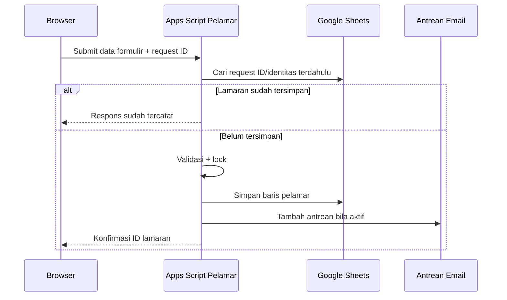

# Kontrak Data dan Alur Utama

> **Status dokumen:** diturunkan melalui analisis statis dari arsip sumber yang diberikan, 31 Oktober 2026. Dokumentasi ini bukan bukti bahwa seluruh integrasi telah diuji secara live atau bahwa implementasi memenuhi seluruh persyaratan keamanan.

## A. Sumber data yang disinggung dalam backend

| Sumber | Kegunaan |
|---|---|
| Data lamaran & identitas | Data lamaran dan identitas, status serta metadata pendaftaran. |
| Master formasi kelompok pusat | Formasi untuk kelompok PAU. |
| Master formasi fakultas | Formasi untuk unit fakultas. |
| Referensi pendidikan | Pencocokan dan validasi pendidikan. |
| Riwayat tahapan seleksi | Status resmi tahapan seleksi. |
| Antrean email | Jadwal dan status email konfirmasi. |
| Hasil seleksi administrasi final | Referensi hasil final Seleksi Administrasi pada modul publikasi. |
| Analisis kandidat internal | Proses analisis di backend admin. |
| Permintaan perubahan kandidat | Jejak permohonan/pergantian kandidat di backend admin. |

Daftar ini **tidak mencakup seluruh sheet teknis** yang mungkin dibuat oleh puluhan patch backend admin. Lihat indeks fungsi private untuk penelusuran lebih lanjut.

## B. Form submit pelamar

Alur ini direkonstruksi dari backend pendaftaran dalam arsip. Referensi nama fungsi dan baris tersedia hanya di dokumentasi private.

## C. Tracking status

1. Browser mengirim email dan HP/WhatsApp yang digunakan ketika mendaftar.
2. Backend menormalisasi identitas dan mencari pelamar.
3. Data tahapan digabung menjadi ringkasan publik; modul tambahan dapat membatasi hasil berdasarkan sumber hasil resmi dan gate publikasi.
4. Browser menampilkan hanya status yang dikembalikan oleh layanan, bukan seluruh isi database.

## D. Kebijakan publikasi

- Penyaringan publikasi dilakukan pada sisi server; kontrol UI saja tidak cukup.
- Ada tahap Seleksi Administrasi, Tes Inteligensia, dan tahap lanjutan menurut fungsi-fungsi publikasi pada file seleksi.
- Gate/QA menggunakan Script Properties; nilai test/identitas test tidak boleh dimuat ke repo public.
- Ketika membaca hasil publik, pastikan daftar yang menjadi *source of truth* memang telah disahkan.

## E. Kebijakan perubahan kontrak

Tiap perubahan kolom, tipe, status, atau respons harus ditinjau bersama formulir dan gateway agar kompatibilitas lintas versi terjaga. Hindari renaming kolom langsung pada database production tanpa migrasi dan backup.
