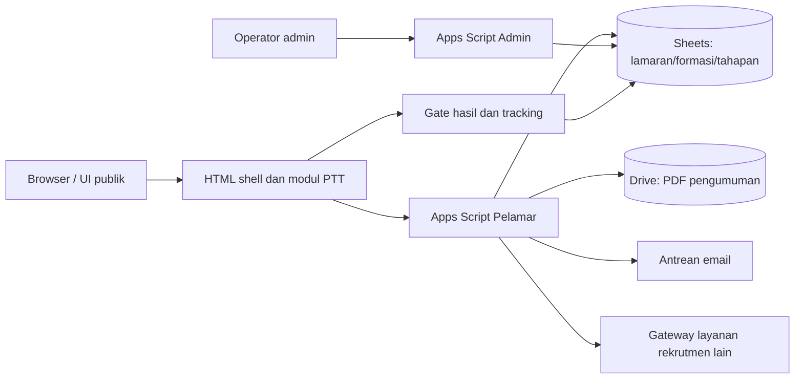

# Arsitektur dan Aliran Kontrol

> **Status dokumen:** diturunkan melalui analisis statis dari arsip sumber yang diberikan, 31 Oktober 2026. Dokumentasi ini bukan bukti bahwa seluruh integrasi telah diuji secara live atau bahwa implementasi memenuhi seluruh persyaratan keamanan.

## Komponen runtime

- Antarmuka berkomunikasi dengan layanan yang sesuai melalui koneksi yang diotorisasi.
- Lazy module pada portal meminta konten HTML modul PTT melalui handler server.
- Google Sheets berfungsi sebagai data store operasional dengan kolom eksplisit; Drive menyediakan dokumen pengumuman.
- Konfigurasi dan akses data dikelola dalam lingkungan terbatas.

## Failure modes

| Kegagalan | Perilaku/mitigasi yang perlu ditelusuri |
|---|---|
| Google Sheets tidak dapat dibaca | Error service sementara dan retry di backend pelamar. |
| Dua submit bersamaan | Lock + cek existing request/identity. |
| Koneksi browser putus | Cek submit melalui request ID, bukan pendaftaran baru otomatis. |
| Hasil belum sah | Gate publikasi dan sanitasi output. |
| PDF tidak publik / tidak ada | Filter file yang boleh terlihat dan pesan kegagalan terkontrol. |
| Layanan lain down | Gateway memetakan kegagalan dan pesan generik. |

Tidak ada bukti deployment topology atau diagram trust boundary di arsip; gambar ini merupakan rekonstruksi hubungan logis dari kode.
